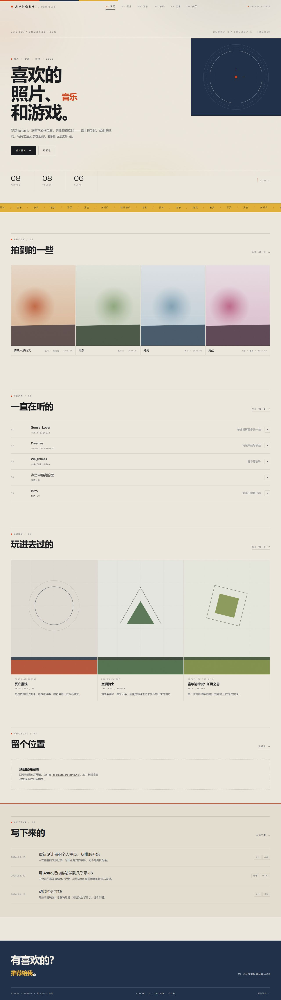

# jiangshi — 收东西的个人站

一个用 [Astro](https://astro.build) 搭的静态个人站：**照片、音乐、游戏**，外加一点文章。项目区先空着，留给以后。
视觉走「工业科幻 HUD」路线——细线网格、瞄准环、等宽标注、单一信号黄；构建产物是纯静态 HTML，可以扔到任何静态托管上。



> `docs/` 里是首页、照片、文章、关于的截图，只是预览用，可以随时删。

## 快速开始

```bash
npm install     # 首次
npm run dev     # 本地开发：http://localhost:4321
```

其他命令：

| 命令 | 作用 |
| --- | --- |
| `npm run build` | 构建到 `dist/` |
| `npm run preview` | 预览构建结果 |
| `npm run astro -- --help` | Astro CLI |

## 目录结构

```
public/
  favicon.svg
  images/            # 头像、瞄准环等静态图
  photos/            # ★ 照片（现在是抽象的 SVG 占位图，换成自己的 jpg/png 就行）
  games/             # ★ 游戏封面
src/
  config.ts          # ★ 站点信息：名字、简介、邮箱、导航、社交链接
  data/photos.ts     # ★ 照片清单：一张一条
  data/music.ts      # ★ 歌单：一首一条
  data/games.ts      # ★ 游戏清单：一个一条
  data/projects.ts   # ★ 项目（现在是空的，文件里有模板注释）
  content.config.ts  # 文章集合的 schema
  content/blog/      # ★ 文章：一篇一个 .md
  layouts/BaseLayout.astro
  components/        # Nav / Footer / PhotoTile / TrackRow / GameCard / ProjectCard
  pages/
    index.astro      # 首页：照片 + 音乐 + 游戏 + 预留 + 文章
    photos.astro     # 照片墙
    music.astro      # 歌单
    games.astro      # 游戏
    projects/        # 项目（预留页）+ 详情
    blog/            # 文章列表 + 详情
    about.astro      # 关于
    404.astro
  styles/global.css  # ★ 全部样式（顶部 :root 是设计变量）
```

## 改内容

### 1. 站点信息

编辑 `src/config.ts`：站点名、一句话简介、邮箱、位置、社交链接、导航项、跑马灯文字。

### 2. 照片 / 音乐 / 游戏

三个数据文件，都是一条一个对象：

```ts
// src/data/photos.ts —— 图放进 public/photos/，src 写路径
{ src: '/photos/dusk.svg', title: '傍晚六点的天', place: '杭州 · 西湖边', date: '2026.09' }

// src/data/music.ts
{ title: 'Sunset Lover', artist: 'Petit Biscuit', note: '单曲循环最多的一首', link: 'https://music.163.com/' }

// src/data/games.ts —— 封面放 public/games/
{ title: '死亡搁浅', subtitle: 'DEATH STRANDING', year: '2019', platform: 'PS5 / PC', note: '一句话感受', cover: '/games/g-stranding.svg' }
```

换图片：把 `public/photos/` 和 `public/games/` 里的 SVG 换成自己的 jpg/png，再把对应 `src`/`cover` 改掉即可。

### 3. 项目（预留）

`src/data/projects.ts` 现在是空数组，填一条就自动出现在 `/projects` 和详情页（文件里有模板注释）：

```ts
{
  slug: 'lumen',            // 详情页地址 /projects/lumen
  title: 'Lumen 音乐播放器',
  tagline: '一句话副标题',
  year: '2026',
  role: '设计 + 前端',
  cover: '/images/cover-lumen.svg',
  accent: '#7cf0c8',
  stack: ['Electron', 'React'],
  featured: true,           // 是否出现在首页精选
  summary: '详情页开头的摘要',
  links: [{ label: '在线预览', href: 'https://…' }],
  sections: [{ title: '起点', text: '正文段落，空行分段。' }],
}
```

### 4. 写一篇新文章

在 `src/content/blog/` 下新建 `my-post.md`，文件名就是网址（`/blog/my-post`）：

```md
---
title: '文章标题'
description: '列表页和 SEO 用的一句话摘要'
date: 2026-10-30
tags: ['设计', '前端']
draft: false
---

正文用 Markdown 写，支持标题、列表、引用、代码块（自带语法高亮）。
```

字段由 `src/content.config.ts` 校验：漏写 `title`/`description`/`date` 会在构建时报错，不会静默出错。

### 5. 换配色 / 字体

`src/styles/global.css` 顶部的 `:root` 里：

```css
--accent: #7cf0c8;   /* 主强调色 */
--accent-2: #93a7ff; /* 渐变中间色 */
--accent-3: #ffb27a; /* 渐变尾色 */
--font-sans: ...;
```

## 发布

**线上地址：<https://jiangshi-73.github.io/>**
仓库：[JiangShi-73/JiangShi-73.github.io](https://github.com/JiangShi-73/JiangShi-73.github.io)（这是 GitHub 的"用户主页仓库"，所以站点在根路径下，不需要 `base`）

改完内容推上去就自动发布：

```bash
git add -A
git commit -m "写了点什么"
git push
```

GitHub Actions（[deploy.yml](.github/workflows/deploy.yml)）会自动构建并发布，大约 1 分钟生效。

### 以后想接自己的域名（jiangshi.com）

代码这边已经准备好，到时候只需要四步：

1. 在**域名所在的那个阿里云账号**里改解析：
   - `@`  A 记录 → `185.199.108.153` / `185.199.109.153` / `185.199.110.153` / `185.199.111.153`
   - `www` CNAME → `jiangshi-73.github.io`
2. 把 `astro.config.mjs` 的 `site` 改成 `'https://jiangshi.com'`
3. 新建 `public/CNAME`，内容就一行：`jiangshi.com`
4. 仓库 Settings → Pages → Custom domain 填 `jiangshi.com`，勾上 Enforce HTTPS

推送后等 DNS 生效即可。

## 二维码

指向站点首页的二维码，扫一下直接打开 <https://jiangshi-73.github.io/>：

| 文件 | 用途 |
| --- | --- |
| `public/qr.svg` | 矢量版，线上地址 `/qr.svg`，任意缩放不糊 |
| `public/qr.png` | 1024px PNG，线上地址 `/qr.png`，适合直接发给人 |
| `docs/qr-poster.png` | 带站名和网址的海报版，适合打印或贴出来 |

换域名后要重新生成：把网址换掉，用 `qrcode` 重新导出即可（错误纠正等级 H，留 2 个模块的静区）。

## 设计说明

- **视觉语言**：米白纸面（`--ink`）+ 墨黑字（`--paper`）+ 三块颜色——赭红 `--signal`、藏青 `--navy`、芥末黄 `--mustard`，走 NASA-punk 那种「航天局印刷品」的味道：细线、编号、等宽标注、直角、整块的颜色
- **色块**：首屏顶部一条三色标尺、右侧藏青色块套准星、跑马灯整条芥末黄、页脚整块藏青；这些是版式的一部分，不是装饰
- **字体**：Archivo Variable（用宽度轴撑到 118%，做大标题和数字）+ JetBrains Mono（标注、日期、编号），通过 npm 自托管，不请求外部 CDN
- **面板**：偶尔用深一档的米色块（`class="panel-paper"`）分出节奏，比如首页的「写下来的」区块
- **换配色**：改 `src/styles/global.css` 顶部 `:root` 里的 `--ink` / `--paper` / `--signal` / `--navy` / `--mustard` 五个值，整站跟着变
- **结构**：每个区块以「细线 + 编号 + 英文标签」的标题行开场，编号由 CSS 计数器自动生成（`counter-increment: sec`），加区块不用手改
- **装饰**：首页瞄准环是手写 SVG（刻度由脚本生成），90 秒转一圈；颗粒用内联噪声；顶部一条彩色光带
- **动效**：入场位移 18px / 800ms / ease-out；`prefers-reduced-motion` 下全部关闭
- **JavaScript** 只有一个 <script>：导航滚动状态、移动端菜单、IntersectionObserver 入场
